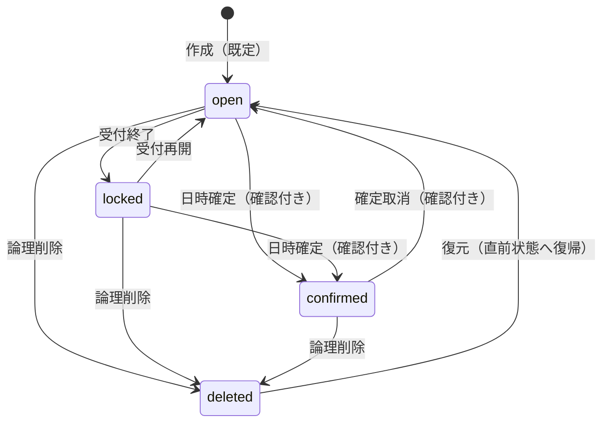
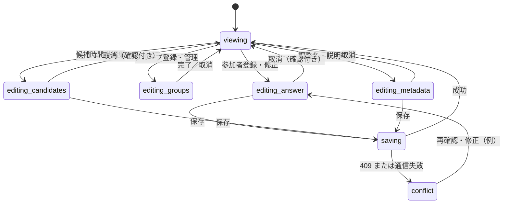

# gyugyu — 本番実装仕様書

- **文書版**：1.0-draft（2026-10-28）
- **根拠**：合意済みのUI試作 v0.5 とその設計内容、ならびに 2026-10-28 に確認した共通BASIC認証での運用
- **対象**：学内・研究室のHTTPS保護された内部Webサイト
- **正式名称**：`gyugyu`。タイトル、URL、ソース、faviconの代替テキスト等ではこの表記のみ使用
- **優先順位**：本書の確定仕様 ＞ 過去の試作品の実装詳細。旧HTMLデモは外観・操作の参考であり、本番コードをそのままコピーする義務はない

> 本文では **[必須]** を合意済みの要件、**[初期方針]** をMVP用の実装判断、**[後続]** を初版に必須でない機能とする。実装上の安全性に関わる変更は、仕様・テストを更新して明示する。

---

## 1. 概要

**gyugyu** は、複数の独立したスケジュール調整をひとつのポータルから管理するWebアプリケーションである。各調整は「案件／インスタンス」と呼ぶ。利用者は案件を開き、各日の30分単位の候補時刻について、参加者ごとに `○`・`△`・`×` を入力する。入力はパレット選択とマウス／タッチのドラッグで行い、グループ単位で集計対象を絞り、時刻ごとの各回答人数を小さな表で比較する。

### 1.1 設計の優先順位

1. **一目で見渡せる高密度な日別の表**。複数日を1本の長い時間軸に並べない。
2. **入力が直感的であること**。30分セル、選択パレット、ドラッグ塗り。
3. **余計なグラフで画面を混雑させないこと**。集計は `○/△/×` の人数3行に一本化。
4. **人数と集計の整合性**。未入力は×にしない。複数グループ所属者は一度だけ数える。
5. **導入・運用が容易であること**。PHP + SQLiteで、既存のHTTPS・Basic認証下に設置。
6. **データを失わないこと**。候補外にした時間帯の回答を保持し、削除には復旧手段を設ける。

### 1.2 技術スタック [必須／初期方針]

- **PHP 8.3以上**、PDO SQLite、SQLite、HTML/CSS、素のJavaScript。必要拡張：`pdo_sqlite`、`mbstring`、`session`。
- 本番でNode.js常駐、React、外部CDN、クラウドサービスを要求しない。開発時にテストツールを使用するのはよい。
- DB・非公開PHPクラス・秘密設定・バックアップはWeb公開ディレクトリ外へ配置。
- ベースパスを設定可能にし、例として `https://example.ac.jp/gyugyu/` 配下で動くこと。`/` 直下決め打ちは禁止。
- 原則同一オリジンのPHP APIで読み書きし、ブラウザーからSQLiteへ直接接続しない。
- モノトーンのシンプルな牛のSVGアイコンをヘッダーとfaviconに使用する。ブランドロゴと回答色を混同しない。

### 1.3 MVPの対象と対象外

**対象**：複数案件のポータル、案件作成・説明編集・論理削除、候補日と候補帯の編集、参加者の登録と相互編集、グループ0〜9件のWeb管理と複数所属・集計マスク、○△×3行数字、スコア、CSV/JSONエクスポート、永続保存、Basic認証下の安全な運用。

**対象外 [後続]**：カレンダーサービス連携、メール送信、説明文からの自動締切、長期編集トークン、個人別ログイン、JSONインポートによる全面復元、複雑な会議所要時間・連続区間探索、通知機能。

---

## 2. 現在の認証と編集権限（重要・2026-10-28確定）

### 2.1 共有BASICアカウントで運用する [必須]

- サイト入口は既存の **HTTPS + HTTP Basic認証** で保護され、**利用者全員が同じBasicアカウント**を使用する。
- **個人別の認証・参加者用編集パスワード・編集トークンは初期実装で不要**。
- Basic認証を通過した利用者は、**自分以外を含む全参加者の登録済み回答を閲覧・修正できる**。氏名および所属グループも変更できる。これは意図的な性善説の運用である。
- この段階では「誰が操作したか」をBasic認証だけで確定できない。操作履歴に氏名やユーザーIDを捏造しない。監査の操作者は `shared-basic`（共通認証）等とし、時刻・操作種類・対象ID・変更内容を記録する。IPを記録する場合も本人の同定とは呼ばない。
- 将来個人ID方式へ変更するときのために、参加者の**不変ID**と認証主体（将来用）は分ける。ただしMVPの画面には個人認証UIを出さない。

### 2.2 操作権限 [初期方針]

| 操作 | 共通Basicを通過した利用者 |
|---|---|
| 案件一覧・詳細・集計の閲覧 | 可 |
| 案件の新規作成、調整名・説明の編集 | 可 |
| 参加者の新規登録・任意の参加者の回答修正 | **可（本人限定にしない）** |
| 参加者の氏名・所属の編集、参加者の非表示化 | 可（確認付き） |
| グループ追加・改名・説明修正・アーカイブ | 可（アーカイブは確認付き） |
| 候補日・候補時間帯の変更 | 可（破壊的な置換・除外は影響プレビュー） |
| 回答受付終了・再開、日時確定・取消 | 可（状態と確認条件に従う） |
| 案件の削除 | **確認付き論理削除のみ可**。即時物理削除は禁止 |
| 案件の復元 | 保持期間内に可（復元専用操作） |

**注意**：共通Basicでは「管理者だけ削除可」という権限を実現できない。初版は全員が削除可能な代わりに、案件名の再入力による確認・論理削除・復元・バックアップを必須とする。後に削除を管理者だけに制限する必要が出た場合は、個別認証または**別の管理用資格情報**を追加すること。Basicの共通IDを管理者IDとして扱わない。

### 2.3 WebサーバーとPHPの境界

- 静的ページ・JS/CSS・API・CSV/JSONダウンロード・管理画面の**すべてをBasic認証付きの保護範囲**に配置する。サーバー設定と無認証時のHTTP 401をデプロイ時に検証する。
- PHPは信頼したWebサーバーが渡す認証済み状態（例：`REMOTE_USER`）を使用する。外部クライアントが送信した `X-Remote-User` 等をそのまま信じない。プロキシ／FastCGIの連携方法をREADMEに記述する。
- Basic認証を外すだけで本番APIが公開される構成にしない。認証主体情報が不足する本番リクエストは**fail closed**とする。
- `php -S 127.0.0.1:8080 -t public` 等の開発サーバーでは、明示した開発モードとloopback接続に限り認証バイパスを可能としてよい。開発モードが本番で有効にならないことをチェックする。
- 個人認証は不要だが、CSRFトークン、Origin検証、Cookie保護、入力検証、書込み時の状態検証は必要。

---

## 3. 画面構成と利用者の動線

| 画面 | 主要内容 | 操作 |
|---|---|---|
| P0 ポータル | 既存案件のリンク、候補期間・回答状況・状態・更新日時 | 開く、新規作成、削除、削除済み復元 |
| P1 新規作成 | 案件名（必須）、説明（任意）、候補日の羅列、初期開始／終了時刻 | プレビュー、作成、取消 |
| P2 案件詳細 | 案件名、説明（あれば）、グループマスク、日別30分表、3行数値集計 | 回答編集、参加者登録、グループ登録、候補帯編集、出力 |
| P3 参加者編集 | 氏名、所属グループ（複数選択）、回答パレットとグリッド | 保存、取消、Undo/Redo |
| P4 グループ管理 | 有効グループ0〜9件、名前・説明 | 追加、編集、アーカイブ |
| P5 候補編集 | 全日／指定日への時間帯一括操作、日付ごとの候補帯のドラッグ編集 | 置換、追加、除外、保存、取消 |
| P6 案件設定 | 調整名・説明、受付状態、日時確定、日付追加・削除 | 変更、受付終了・再開、確定 |

P3〜P6は別URLでも詳細画面内のモーダル・パネルでもよい。ただし、編集中に無関係なモーダルを開いて下書きが消えるようにしない。モバイルではレイアウトが崩れず、横方向にスクロールできること。

### 3.1 ポータル [必須]

- 通常のクリック可能な `<a href>` で各案件詳細へ遷移できる。JavaScriptによる遷移だけに依存しない。
- 一覧には **案件名、候補日数または期間、参加者数・回答済人数、案件状態、最終更新日時、開く／削除**程度を表示。
- **説明文は一覧・検索結果に表示しない**（抜粋、ツールチップ、検索用自動タグも既定ではなし）。一覧検索を実装する場合は案件名を対象にする。
- 「＋ 新しいスケジュール調整」を上部に置く。更新日時降順を既定とする。
- 削除済み案件は通常の一覧から隠し、「削除済みを表示／復元」を明示的に選んだ場合だけ確認可能にする。

### 3.2 新規作成フォーム [必須]

入力項目：

1. **スケジュール調整名** `title`：必須、トリム後1〜140文字、日本語可。同名の案件を許可し、IDで区別する。
2. **説明** `description`：任意、複数行 `textarea`。空文字可、最大2,000文字を初期制限とする。△の扱い、返信期限の案内、会議内容を記述できる。**文章で「締切」と書いても自動受付停止にはならない**。
3. **候補日リスト**：必須、ISO日付 `YYYY-MM-DD` を1行1つ入力。複数日を許可、重複は一意化して明示、無効日付はエラー。ローカル日付の昇順で表示する。
4. **全候補日に適用する初期時間帯**：開始時刻・終了時刻、30分刻み。初期値は `09:00–18:00` を推奨し、表示軸内（06:00〜翌06:00）を使用。時刻が翌日にまたがる場合は「翌日」を明示して入力できる。

プレビューでは候補日数・スロット数・日付の重複警告・各日の有効範囲を確認する。作成操作はインスタンス／日付／各日48スロットを**単一DBトランザクション**で保存。作成直後の初期状態は `open`（受付中）。グループ0件、参加者0件で作成してよい。

### 3.3 案件の説明 [必須]

- 詳細画面の**案件名の直下**に表示し、改行を保持する。`white-space: pre-wrap`等で**プレーンテキスト**として描画。HTML・Markdownは実行／解釈しない。
- 空欄なら説明カードそのものを描画しない。
- 「調整名・説明を編集」から後で修正・削除（空欄にする）できる。変更しても案件ID・候補日・参加者・回答を保持する。
- 保存時に改行を `\n` に正規化する。HTMLタグは文字列としてエスケープする。説明文の変更は案件の更新日時とバージョンを更新する。

### 3.4 案件削除・復元 [必須]

- 一覧の`削除`で確認ダイアログを表示し、対象**案件名の再入力**を求める。入力が一致した場合のみ削除APIを呼ぶ。
- APIは案件ID・確認値・CSRF・編集競合の版数を再検査する。ブラウザーの`confirm()`だけでの保護は不可。
- `deleted_at` を記録する**論理削除**とし、通常のAPI一覧・詳細画面からは非表示。回答やグループを物理削除しない。
- 復元は**削除前の状態**へ戻す。**MVPでは復元期限を設けず、物理削除機能も自動物理削除も実装しない**。運用が固まった後に、例えば30日の復元期限とバックアップ保持ポリシーを別途定める。
- 復元画面も共通Basic認証内。操作ログを残すが、編集者個人の特定はできない旨を明示する。

---

## 4. 日付ごとの高密度スケジュール表 [必須]

### 4.1 1日1パネル、縦積み

- **1枚の横長テーブルに1日分**の表示軸と参加者を収め、対象日数だけ縦に積む。異なる日付の時間を横につなげたり、日付を1列に圧縮しない。
- 各日について、表示軸は原則 **当日06:00から翌日06:00まで** の48個の30分セル。候補外セルも幅を維持して灰色表示。
- 時間ヘッダーは **1時間ごとに時の2桁だけ**表示する。`06 07 08 … 23 24 01 … 05`。1時間のラベルは2つの30分列にまたがる。`24`は翌日00時を表す表示だけの記法。
- 先頭日付はパネルの**ローカル日付**。例：11月2日のパネルの `24:00` は11月3日00:00。後続の11月3日のパネルは11月3日06:00からで、同じ絶対時間の重複を作らない。

### 4.2 サイズ、横スクロール、見え方

| 要素 | デフォルト | 備考 |
|---|---:|---|
| 1スロットの横幅 | **16px** | 表示設定で20px/24pxにも変更可 |
| 参加者セルの高さ | **約26px** | 横幅より縦に長い |
| 氏名列の幅 | **約148px** | 横スクロール時も左に固定 |
| ヘッダーの高さ | 約25px | 2セルで1時間のラベル |
| 1日あたりの時間セル | **48列** | 16×48=768px |
| 1日表の総幅 | **約916px** | 148px + 768px（境界線の微差は可） |

- CSSでは列幅を固定し、`table-layout: fixed`＋`colgroup`等を用いる。**画面幅を埋めるために30分セルを自動拡張しない**。
- 狭い画面は日付パネル内の時間方向にスクロールし、氏名は固定する。タッチ端末では20/24pxを選べる。
- 通常のセル内に`HH:mm`を印字しない。正確な時刻はホバー・キーボードフォーカス・タップ時の詳細で示す。
- セルの状態は色**と形状記号の両方**で表す。○：青系＋白点、△：黄系＋三角、×：灰系＋×、未入力：白、候補外：薄い灰色。色だけに依存しない。
- モノトーンの牛アイコンはブランド用途に限定する。

### 4.3 表示モード

- `全員表示`：全参加者の回答行 + 集計3行。マスク対象外の人の行は薄くするか区別する。
- `対象者のみ表示`：現在のマスクに含む参加者の回答行 + 集計3行。
- `集計のみ`：参加者行を折りたたみ、集計3行を表示。各時刻を選ぶと○／△／×／未入力の**名前の内訳**を確認できる。
- **割合ヒートマップ、色濃度による集計、棒グラフは実装しない**。この要求は以前のデザイン案を上書きする。

---

## 5. 参加者と回答の編集 [必須]

### 5.1 セルの4状態

| UI | API/DB上の意味 | カウント |
|---|---|---|
| ○ | `yes` | ○人数 `Y` |
| △ | `maybe` | △人数 `T` |
| × | `no` | ×人数 `X` |
| 空欄／— | `unknown` | 未入力人数 `U` |

- **未入力を×へ変換しない**。DBの `answers` にレコードが無いときは `unknown`。クリアすると該当レコードを削除する。
- 候補外 `is_candidate=false` のセルは回答モードで編集不可。以前の回答データは保持する。

### 5.2 新規参加者登録

`参加者を登録` → 氏名（必須）→ 所属グループを0〜複数選択（グループ0件ならフィールドを隠す）→ 回答パレットを選択→セルをクリックまたはドラッグ→`保存`。

- 参加者IDはUUID等の不変ID。氏名と識別子は分け、同姓同名も別参加者として保持可能。表示上は同名時に補助識別子を示す。
- 氏名の初期制限は1〜80文字。保存途中の下書きを保持し、取消時は未保存の変更があるなら確認する。
- 参加者／所属グループ／全回答は**一つのトランザクション**で作成。フォームを途中で閉じただけではDBに未回答参加者を作らない。
- 一度保存した参加者で、回答セルがすべて未入力であっても参加者は存在し、以後の集計分母に含む。ポータルの「提出済み」は `submitted_at`（明示保存した日時）で判定し、○の有無と混同しない。

### 5.3 既存参加者の修正（共通アカウント運用）

- **すべてのBasic認証済み利用者が、表の氏名または編集ボタンから任意の参加者を編集できる**。本人確認パスフレーズを要求しない。
- 氏名、所属グループ、セルの回答を変更できる。保存時に`participant_version`を検査し、別端末が先に更新した場合はHTTP 409とし、黙って上書きしない。
- 通信エラーでは画面の入力内容を破棄しない。現在の保存状態を「編集中」「保存中」「保存完了」「保存失敗」で明示する。
- 参加者の削除は直ちに回答を消すのでなく**非アクティブ化**とし、現在の集計対象から除外。復帰すれば以前の回答を回復できる方式を推奨する。

### 5.4 パレットとドラッグ操作

- パレットは `○` / `△` / `×` / `クリア`。パレットクリックで選択状態を変える。セルのクリック／ドラッグ中は選択した状態で**置換**する。セル状態をクリックごとに順送りする方式は必須ではない。
- Pointer Eventsを用いてマウス、タッチ、ペンに対応。1回のドラッグを1つのUndo操作単位とする。`Undo` / `Redo` / `取消` を提供。
- 選択解除・画面外への移動・pointer cancel等で塗り続けない。ドラッグ中のテキスト選択を抑制する。
- キーボード操作とフォーカス時の時刻／状態読み上げも可能な構造にする。
- 回答編集と候補時間帯編集は排他モード。閲覧中に不用意にセルが書き換わらない。

---

## 6. グループのWeb管理と集計マスク [必須]

### 6.1 グループは0〜9個

- 各案件に**0〜9件**の有効グループ。0件を正規の状態として認める。名前なしのダミーグループは作らない。
- `全員`はDB上のグループではなく、**仮想的な集計モード**。
- 案件詳細に「グループを登録」と「グループを管理」を用意し、Web上で追加・改名・説明編集・アーカイブできる。サーバー端末でのファイル編集は必須ではない。
- グループ名 `name` は**必須**（1〜60文字）、説明 `description` は**任意**（最大500文字）。同じ案件内で正規化後の同名アクティブグループを禁止。名称の変更ではIDを変えない。
- 9件に到達したら追加UIを無効化し、サーバー側も10件目を拒否。アーカイブ後に新規追加は可。復元時にも9件制約を再検証。
- グループアーカイブ時は所属中の参加者数と影響を確認し、回答自体は保持する。集計マスク選択肢から外し、該当グループのみへの所属は現在の集計には使用しない。

### 6.2 所属は複数選択

- 参加者は**0個以上**の有効グループに所属できる。グループ選択はチェックボックス等の**複数選択UI**。
- 多対多の関連テーブルで管理する。1人が2グループに属していても集計では1人である。
- グループ変更で既存の回答内容を変更しない。

### 6.3 グループマスクの厳密な意味

有効参加者全体を `P`、選択されたアクティブグループ群を `K`、グループ `g` の参加者集合を `G(g)` とする。表示・集計の対象 `M` は以下で定める。

- `全員`：`M = P`。
- `選択グループを含む`：`M = P ∩ ⋃(g∈K)G(g)`（OR、和集合）。**Kが空ならMも空**として「グループ未選択」を表示し、全員集計へ暗黙復帰しない。
- `選択グループを除外`：`M = P \ ⋃(g∈K)G(g)`。**Kが空ならM=P**。

この `M` に属する人だけを一度ずつ数える。表示には「対象N人／未入力U人」を示す。**グループ0件**ではマスクUIを隠し、自動的に `全員` モードを用いる。マスク設定はブラウザの表示状態であり、回答のDBデータを書き換えない。

### 6.4 グループプリセット [任意]

- `group_presets.json` は導入先が使いたければ設定できる**フォーム入力の補助**にすぎない。`name`・`description`を読み込み、新規グループ入力欄を事前入力してよい。
- **DBに登録したグループが正本**。JSON編集が既存案件を無断変更しない。プリセットなしでもグループ0件の案件を正常に作成・運用できる。
- 読み込む設定JSONはWeb公開領域外。安全な検証を行い、ファイル不備はフォームの任意機能の不具合として通知する。

---

## 7. 時間候補帯の作成と編集 [必須]

### 7.1 48セルの候補マスク

各案件の日付パネルごとに、30分セル48個を持ち、それぞれ `is_candidate=true/false` とする。開始・終了時刻の1組だけを保持するのではなく、**途中に穴のある任意の候補帯**を保存できること。

- 作成時は指定した全日付に同一の開始〜終了の候補帯を設定する。
- 候補外は灰色で編集禁止、集計・通常ランキングから除外する。
- 候補外に変更しても、**以前の回答レコードを削除しない**。再度候補に戻せば表示・集計も復元する。

### 7.2 一括操作

候補編集画面では「対象日＝全日／選択した複数日」と「開始〜終了時刻」「操作種別」を指定する。

| 操作 | 意味 |
|---|---|
| **置換** | 指定した時間帯のみ候補にし、その日の他の候補セルは候補外にする |
| **追加** | 指定した時間帯を候補にする（既存の候補は維持） |
| **除外** | 指定した時間帯を候補外にする（他の候補は維持） |

- 置換・除外の前に**対象日数、変更セル数、見えなくなる既存回答数**をプレビューして確認させる。
- 空白時間帯や表示軸外の時刻を受け付けず、0分長さを禁止する。日時はローカル日付+オフセットで正しくUTCへ対応付ける。
- 候補マスクの同時更新は `schema_revision` 等で競合検出する。

### 7.3 セルをドラッグして候補除外

- 候補帯の行で `候補にする` / `候補外にする` パレットを選び、30分セルをドラッグして塗る。
- 操作中は回答の編集モードへ入らず、逆も同様。Undo/Redoは1ドラッグ単位。
- 保存前に対象スロットの変更数を表示。保存失敗では下書きを保持する。
- 日付の追加・削除も案件設定から可能とし、削除時は回答件数を提示して**論理削除**。再追加時は同じ日付の履歴を扱う設計を優先し、無条件で上書き・初期化しない。

---

## 8. 3行の人数集計と候補順位 [必須]

### 8.1 集計の定義

1つの候補スロットに対し、現在のマスクの対象者数を `N=|M|` とする。

- `Y`：○の人数
- `T`：△の人数
- `X`：×の人数
- `U`：未入力の人数

**常に `Y + T + X + U = N`**。同じスロットの○・△・×の数は参加者行の直下に**3行の数値だけ**表示する。未入力は集計対象から消さず、ツールチップ・上部の対象者数／未入力表示で確認できる。`N=0`のとき数値とスコアは `—` とし、全員○とみなさない。候補外の列は集計を表示しない。

### 8.2 四則演算だけのスコア

ユーザーの優先順は**(1) ×が少ない、(2) ×が同数なら○が多い**である。同じマスク集合（同じ `N`）の時刻間では、次式をスコアとして降順に並べればよい。

```text
score = Y - (N + 1) * X
```

- `X`が1減少すると `N+1` 点有利になる一方、`Y`の差は最大`N`。したがって○人数の違いは、×人数の違いを逆転しない。
- 例：`N=5` で `(Y=4,X=0)`→`4`、`(3,0)`→`3`、`(4,1)`→`-2`。この順に優先する。
- 第3順位は設けない。`X`も`Y`も同数なら同点（その場合`T`と`U`の差は順位を動かさない）。表示だけ日時順に並べてよい。
- 別マスク条件では`N`が変わるため、**異なるマスク間でスコアの絶対値を比較しない**。
- `N=0` または候補外は `score=null`。
- `U>0` の候補は `provisional=true`（暫定）。スコアは計算するが**回答が揃った候補と誤認させない**。`U=0`でのみ回答完了と判定する。
- 全員○は `N>0 && Y===N` の場合だけ。ヒートマップを復活させず、必要なら小さな枠線やアイコンで示す。

### 8.3 スコアのUI

- スコアを全30分列に4行目として追加しない。日付見出しの推奨候補、選択した時刻の詳細、または小さな順位一覧で確認できるようにする。
- 表示モード・グループマスクを切り替えると、○△×人数、暫定フラグ、順位、名前の内訳は**同じ対象集合**から再計算する。
- 第1版は30分スロット単位で順位を決める。連続60/90分の候補推奨は後続機能とする。

---

## 9. 編集と案件の状態遷移 [必須]

### 9.1 案件ライフサイクル



- `open`：回答追加・編集可。
- `locked`：回答変更不可、閲覧・集計・出力可。再開は明示操作。
- `confirmed`：日時・決定時の対象マスク・確定日時・操作時刻を記録。回答や候補帯の編集を禁止する。変更するには確定を取り消す。
- `deleted`：表示上の状態であり、データは保持。復元時には**削除前の状態へ復帰**する（図は簡略表示）。
- 案件メタデータやグループ変更の許容範囲は`open`を基本とし、`locked`/`confirmed`における編集の可否をサーバー側で一貫して制御する。初版は保守的に`confirmed`の構造変更を禁止する。
- **画面上のボタンを隠すだけでは状態制御にならない**。APIで検証する。

### 9.2 ブラウザーの編集状態



- 上図の`conflict`からの戻り先は実際には元の編集モード。409の場合は最新版との違いを示して再読込・やり直しを促す。
- 編集中はモード名、未保存状態、成功・失敗を明示。グループマスクの変更は閲覧UIの状態変更であり、回答の書込みではない。

---

## 10. データモデル（SQLiteへの要求）

DDLの詳細はマイグレーションで確定する。ここでは**意味・関連・制約**を固定する。

| テーブル | キーと主要カラム | 要件 |
|---|---|---|
| `instances` | `id`, `title`, `description`, `timezone`, `status`, `version`, `schema_revision`, `deleted_at`, `status_before_delete`, `created_at`, `updated_at` | 1案件。不変ID。説明は`NOT NULL DEFAULT ''` |
| `instance_days` | `id`, `instance_id`, `local_date`, `sort_index`, `archived_at` | 1案件の候補日。日付重複不可（復元を考慮） |
| `day_slots` | `id`, `day_id`, `ordinal`, `starts_at_utc`, `ends_at_utc`, `is_candidate` | 各日48スロット。`ordinal`は0..47、同一日で一意 |
| `instance_groups` | `id`, `instance_id`, `name`, `name_key`, `description`, `archived_at`, `sort_index` | 有効グループ0〜9。名前の衝突を防ぐ |
| `participants` | `id`, `instance_id`, `display_name`, `version`, `is_active`, `submitted_at`, `created_at`, `updated_at` | 不変ID。`submitted_at`は保存済み回答の提出判定（全セル未入力でも提出可）。共通Basicのため個別編集秘密値は不要 |
| `participant_groups` | `(participant_id, group_id)` | 多対多。一人と一グループの組を重複不可 |
| `answers` | `(participant_id, slot_id)`, `state`, `updated_at` | `state ∈ {yes,maybe,no}` のみ。未入力は行なし |
| `audit_log` | `id`, `instance_id`, `actor`, `action`, `summary_json`, `created_at` | `actor=shared-basic` 等。本人特定を主張しない |
| 確定情報 | `confirmed_start_utc`, `confirmed_end_utc`, `confirmed_mask_json`, `confirmed_at` 等 | 案件に紐付けて保存。MVPは30分候補1枠の確定でも可 |

### 10.1 整合性・トランザクション

- SQLite `PRAGMA foreign_keys=ON`。IDを主キーに、必要な列へ索引。参加者・所属グループ・回答スロットが**すべて同じ案件**に属することをサーバー側トランザクション内で検証する（可能なら複合外部キー等も使用）。
- 1件のインスタンスに有効グループは最大9。**同時INSERT**と**アーカイブ復元UPDATE**の両方に対し、DB制約／トリガーとPHPで防ぐ。
- `instance_days`／`day_slots`は再編集でも識別子を安易に付け直さず、回答の参照整合性を維持する。
- `answers`に `unknown` を保存しない。全体を原子的に保存するとき、クリア分は該当行をDELETEする。
- `instances.version`はタイトル・説明・状態・削除等のメタデータ変更で増分。`instances.schema_revision`は候補日・候補帯・グループ構造の変更で増分。`participants.version`は氏名・所属・回答の変更で増分。
- 変更APIは読み込み時の期待版数を送信し、競合時は **409 Conflict**。保存内容を無言で失わない。複数レコード更新はトランザクションで行う。
- `journal_mode=WAL`、`busy_timeout`、短い書込トランザクション、適切なバックアップ／整合性確認を使用する。

### 10.2 データ境界

- ブラウザーの`localStorage`は**表示設定や未保存下書きの補助**に限る。本番の正本はSQLite。v0.5 HTMLの保存キーを本番DBの代わりに使わない。
- グループマスク・集計スコア・表示密度などは基本的に保存済み回答と独立した派生状態。グループ構成に応じて照会時に再計算。
- CSV/JSON出力にパスワード・セッション・秘密設定を含めない。

---

## 11. PHP API（論理エンドポイント）

例示する`/api/...`は論理API。PHPのルーティング方式はWebサーバー構成に応じて変更できるが、**メソッド・認証・整合性要件は固定**する。rewriteに依存しない`api/index.php`フロントコントローラとしてもよい。

| メソッド | 論理パス | 処理 |
|---|---|---|
| `GET` / `POST` | `/instances` | ポータル一覧／案件作成 |
| `GET` / `PATCH` / `DELETE` | `/instances/{id}` | 案件詳細／調整名・説明・状態変更／論理削除 |
| `POST` | `/instances/{id}/restore` | 削除済み案件を復元 |
| `POST` / `DELETE` | `/instances/{id}/days` | 候補日の追加／論理削除（対象ID指定） |
| `PUT` | `/instances/{id}/days/{day_id}/candidate-mask` | 1日48セルの候補真偽マスクを保存 |
| `PATCH` | `/instances/{id}/candidate-slots/bulk` | 全日／選択日で置換・追加・除外 |
| `GET` / `POST` | `/instances/{id}/groups` | グループ一覧／新規登録 |
| `PATCH` / `DELETE` | `/instances/{id}/groups/{group_id}` | グループ編集／アーカイブ |
| `POST` | `/instances/{id}/participants` | 新規参加者＋グループ所属＋回答を一括保存 |
| `PATCH` | `/instances/{id}/participants/{participant_id}` | 既存参加者氏名・所属変更／非アクティブ化（単独更新） |
| `PUT` | `/instances/{id}/participants/{participant_id}/submission` | **氏名・所属・回答をまとめて原子的に保存**（画面の「保存」の正式API） |
| `PUT` | `/instances/{id}/participants/{participant_id}/answers` | 回答だけを一括置換（期待版数付き、必要な場合） |
| `GET` | `/instances/{id}/summary` | グループマスク別のY/T/X/U・スコアと暫定判定 |
| `GET` | `/instances/{id}/export` | CSV／JSONダウンロード |
| `POST` | `/instances/{id}/lock` / `reopen` / `confirm` / `unconfirm` | 状態遷移 |

### 11.1 データ契約の例

新規作成：

```json
{
  "title": "共同実験の日程調整",
  "description": "△は参加できる可能性がある場合に選択してください。\n11月1日までの回答をお願いします。",
  "dates": ["2026-11-02", "2026-11-04"],
  "initial_window": { "start": "09:00", "end": "18:00" },
  "timezone": "Asia/Tokyo"
}
```

- 説明省略は空文字。`PATCH`で`description`を省略した場合は変更なし、`"description":""`でクリア。
- 初版で利用するタイムゾーンは **`Asia/Tokyo` に固定**し、他のタイムゾーン指定は検証エラーとする（夏時間のある地域の「1日48セル」の意味を曖昧にしないため）。日時はローカル日付から計算し、DBにはUTCの正確な開始・終了を保存する。

参加者の回答保存（例。`PUT .../submission`で氏名・所属も同時に送信する場合は同じトランザクションで処理）：

```json
{
  "expected_participant_version": 2,
  "expected_schema_revision": 5,
  "display_name": "山田",
  "group_ids": ["uuid-group-a", "uuid-group-b"],
  "answers": [
    {"slot_id": "uuid-slot-1", "state": "yes"},
    {"slot_id": "uuid-slot-2", "state": "maybe"},
    {"slot_id": "uuid-slot-3", "state": "no"}
  ]
}
```

- **対象参加者の全有効スロット回答を置換**するAPIであると定義する（指定しない候補セルは未入力に戻す）。更新対象が明示的で、部分PATCHと取り違えないようドキュメント化する。
- 候補外スロットの過去回答は保持する。PUTで候補外の回答を消去・上書きしない。
- 画面の「保存」は `PUT .../submission` を用いて氏名・所属・全回答・`submitted_at`・`participants.version`を**1トランザクションで更新**する。回答だけを編集する別APIを提供する場合も一括PUTの置換範囲を明記する。

集計1スロット（例）：

```json
{
  "slot_id": "uuid-slot-1",
  "target_count": 5,
  "counts": {"yes": 3, "maybe": 1, "no": 0, "unknown": 1},
  "score": 3,
  "provisional": true,
  "all_yes": false
}
```

- JSON応答でグループID・スロットIDが現在の案件に属することを検証し、不正な入力は4xxで拒否する。
- 更新APIにはCSRFトークン、版数情報、入力の長さ・型・境界チェックを求める。
- 未認証401、権限不足403、入力誤り400/422、版数競合409、見つからない404/410などを一貫して扱う。

---

## 12. エクスポート [必須]

1. **CSV（ワイド）**：行＝参加者、列＝日付・30分スロット、セル＝`○/△/×/空欄`。集計は必要なら別ファイル。
2. **CSV（ロング）**：`instance_id,participant_id,name,groups,slot_start,slot_end,state` 等。解析しやすい。
3. **集計CSV**：現在のマスク条件、対象人数N、各候補スロットのY/T/X/U・スコア・暫定フラグ。
4. **JSON（完全な論理エクスポート）**：案件名、**説明の改行**、タイムゾーン、候補日、全48スロット・候補マスク、グループと所属、参加者、回答、状態・版数。候補外スロットに残された回答も含める。秘密値は含めない。

- 通常CSVは「有効候補スロットのみ」を基本とする。完全な回答履歴はJSONで出力できる。全員分とマスク対象分を区別する。
- Excel等での数式注入（先頭 `= + - @` 等）を防ぐ。ユーザー入力テキストを単にダブルクォートするだけでは不十分なケースがあるため安全処理を実装する。
- 出力は共通Basic認証下。ファイル名は安全な識別子・日時を使い、Content-Type/Dispositionを正しく送信する。
- JSONインポート／自動完全復元は後続。バックアップ用途のJSON出力だけでSQLiteの物理バックアップを代替しない。

---

## 13. セキュリティ、バックアップ、運用

### 13.1 セキュリティの確認事項

- HTTPSが必須。Basic資格情報を平文HTTPで流さない。HTTP→HTTPSの転送、キャッシュの扱いを確認。
- 保護対象パスを包括的に確認し、**未認証GETでポータル/API/エクスポートが取得できない**ことを実運用サーバーで検証する。
- PHPのSQLは必ずPDOプリペアドステートメント。アプリのDB接続権限を絞る。
- `title`、`description`、グループ名、氏名をHTMLとして解釈せずに描画。HTML埋込・JSテンプレート文字列を通じたXSSに注意する。
- 変更APIはCSRFトークン、Origin検証、`Secure`/`HttpOnly`/`SameSite`属性を備えたセッションCookie、適切な入力長制限を備える。
- CookieやHTTPレスポンスに意図しない認証情報・DBファイルを露出しない。
- エラーメッセージに生SQL、DBパス、秘密設定を出さない。
- SQLデータ・バックアップをGitに入れない（`.gitignore`を用意）。

### 13.2 復旧可能性 [必須]

- SQLiteはアプリ停止を要しない適切な方式（SQLite Backup API、`VACUUM INTO`等）でバックアップし、WALファイルだけのコピーや稼働中のDB本体のみの無保証コピーに依存しない。
- 保存先、頻度、復元手順をREADMEに記述し、検証環境で復元テストする。
- 案件削除は論理削除であり、操作者個人の識別ができなくても復旧できる。
- マイグレーションはバージョン管理し、重複実行で破損しない。稼働DBへの更新前にバックアップを取る。

---

## 14. 推奨ディレクトリ構成

```text
gyugyu/
├── AGENTS.md                 # Codexのリポジトリ共通作業規則
├── README.md                 # 準備・起動・デプロイ・バックアップ・テスト
├── .gitignore
├── docs/
│   └── SPEC.md               # 本書。製品仕様の正本
├── public/                   # Webからアクセスできる唯一のドキュメントルート
│   ├── index.php             # 案件ポータル
│   ├── create.php            # 新規案件
│   ├── event.php             # 案件詳細（idパラメータで識別）
│   ├── api/
│   │   └── index.php         # PHP API入口
│   └── assets/
│       ├── gyugyu.css
│       ├── gyugyu.js
│       └── gyugyu-cow.svg
├── src/                      # 公開しないPHPドメイン・DB・認証処理
├── database/
│   └── migrations/           # DBスキーマの履歴
├── config/
│   └── examples/             # 秘密情報を含まない設定テンプレート
└── tests/                    # PHP単体/統合・ブラウザーUI試験
```

- 本番の**SQLiteファイル、backup、実際の設定ファイルは`public/`外かつGit管理外**とし、配置先を環境変数等から指定する。
- アプリの`public/`をドキュメントルートにできないホスティングでは、`src/`、`database/`、`config/` がURLから取得できないよう明確にサーバー設定を行う。単に`.htaccess`の存在を前提にしない。
- 実装開始時にREADMEとセットアップ用のCLI（DB初期化・マイグレーション・設定検証）を用意する。

---

## 15. 受入テスト（初版完成判定）

### 15.1 ポータル・新規作成・説明

- [ ] 同じ案件名の複数インスタンスを別IDで作れる。通常の`<a href>`で開ける。
- [ ] 日付を羅列して09:00–18:00を一括適用し、作成後に各日の候補帯が正しい。
- [ ] `title`空では保存不可、`description`空では正常保存。複数行の説明を後から変更・消去できる。
- [ ] 説明は詳細画面のみ表示。ポータルの一覧・検索結果には本文も抜粋も出ない。
- [ ] 説明に`<script>alert(1)</script>`と記入しても実行せず文字列として表示される。
- [ ] 論理削除は案件名再入力と確認が必要。削除済みURLは通常閲覧できず、復元で回答を含め元に戻る。

### 15.2 共通Basicと権限

- [ ] **共通Basicを通った別の端末／利用者が、既存の他人の回答をパスワードなしで修正できる**。
- [ ] 個人別のログイン、参加者用編集トークン／編集PINが要求されない。
- [ ] 未認証状態でポータル、API、出力へアクセスできない。本番で認証設定を外すとAPIもFail closedになる。
- [ ] 監査ログは本人名を捏造せず`shared-basic`等と表示。
- [ ] CSRF保護・パラメータ検証が動作し、不正な更新リクエストが拒否される。

### 15.3 UIと集計

- [ ] 各日付が独立した48セルの表。16px/30分の固定幅を維持し、ウィンドウが広くても伸びない。
- [ ] 時刻ヘッダーは1時間ごとの2桁表示。全30分列に`HH:mm`を表示しない。
- [ ] 個人セルに○・△・×・未入力が明確に表示され、ドラッグで編集できる。
- [ ] 集計は○△×の**3行数字のみ**。棒グラフ、濃度ヒートマップを表示しない。
- [ ] すべての有効候補セルで `Y+T+X+U=N`。
- [ ] `N=5` 等の全回答組合せで `Y-(N+1)*X` の並びが（×昇順、○降順）と一致。
- [ ] 未入力が残る候補は「暫定」。`N=0`や候補外ではスコアなし。

### 15.4 グループ・候補帯

- [ ] グループ**0件**の案件で参加者登録・全員集計が動作。
- [ ] Webでグループ名のみ入力して登録可能。説明は任意。9件まで、10件目は拒否。
- [ ] 複数所属者をグループORマスクで**一度だけ**数える。含む／除外／全員が正しく動く。
- [ ] 候補日を縦に複数表示し、全日／複数日へ`置換・追加・除外`が一括適用できる。
- [ ] 候補時間帯をドラッグで無効化後、以前の回答は集計から外れ、再有効化で復元する。
- [ ] 回答編集と候補編集は排他。変更の取消・Undo・保存の状態が明確。

### 15.5 永続化・競合・エクスポート

- [ ] DBはSQLiteで、ブラウザーを閉じ別端末で開いても回答が一致する。
- [ ] 同じ参加者を2端末で編集し、競合した保存を409で拒否する。
- [ ] CSVワイド／ロング、集計CSV、完全JSONを出力。JSONは説明・候補外の履歴回答を保持。
- [ ] CSV数式注入対策を実施し、氏名・説明のHTMLエスケープを確認。
- [ ] DBを公開URLから直接ダウンロードできない。バックアップからの復旧を実際に検証済み。

---

## 16. Codexによる推奨開発順序

1. **基盤**：リポジトリ構成、README、設定例、PHPルータ、SQLite初期化／マイグレーション、認証境界のテスト、CIで実行できるテスト基盤。
2. **複数案件とポータル**：作成、日付羅列、初期候補窓、タイトル／説明編集、ページ遷移、永続化。
3. **グリッドと候補帯**：日別48列×16pxの表、候補時間の全日／選択日一括適用、候補帯のドラッグ編集、版数競合。
4. **参加者とグループ**：参加者登録、共通Basic下での他人の回答編集、グループWeb管理0〜9件、複数所属とマスク。
5. **集計**：○△×3行数字、未回答U、スコア、ランキング、詳細表示。
6. **運用**：CSV/JSON、状態遷移、論理削除・復元、セキュリティ・バックアップ、ブラウザー回帰試験。

**最初のCodexタスク**では、一度に全機能を実装させるのではなく、リポジトリの骨格・DB・API・ポータルの最小の縦断経路までに範囲を絞る。その後、各フェーズでテストしながら機能を増やす。

---

## 17. 仕様上の決定と残る導入作業

### 確定していること

- プロジェクト名：**gyugyu**、モノトーンの牛アイコン。
- **共通BASIC認証**、認証済み利用者は**他人の回答を自由に修正可能**。初期個人認証なし。
- PHP + Vanilla JS + SQLite、HTTPS保護下、複数案件ポータル。
- タイトル必須・説明任意（複数行、詳細ページだけで表示）。
- 1日1テーブルを縦に積む、06時〜翌06時、30分16px（表示幅切替可）。
- 候補帯の一括変更／ドラッグ変更、候補外の回答は保存。
- グループ0〜9個、Webで登録・編集、所属とマスクが複数選択可能。
- ○△×3行数字、ヒートマップ・棒グラフなし、スコアは `Y-(N+1)*X`。
- 削除は確認付きで論理削除、復元可能。

### 導入環境で検証すること（製品仕様の未決事項ではない）

- Apache/nginxとPHP-FPMの実際の設定、認証済み情報の安全な伝達方法、URLベースパス。
- SQLite DBとバックアップ保存先、権限、バックアップ頻度、復元演習。
- 本番でのPHP・SQLite拡張のバージョン、静的資産への認証適用、TLS設定。

### 将来の仕様改訂が必要なもの

- 個人IDへの移行と本人別の権限、削除者を特定できる監査。
- 説明文とは別の機械的な締切、通知、会議所要時間を伴う連続候補の評価。
- 案件状態に対するより詳細な承認ワークフローや個別の管理パスワード。

**本書を初版実装の機能要件の正本とする。**

## 18. 第1実装段階の実装方針（レビュー対象）（2026-10-28）

本節は実装上の初期方針を記録し、未承認のUX判断を確定仕様に追加するものではない。日付の上限と翌日開始の入力方法はオーナー確認対象とする。

今回の実装は基盤と複数案件CRUDに限定する。回答編集・参加者・グループ・集計・出力・状態遷移UIは後続段階とし、完成したものとして表示しない。

- 新規作成の時間帯に `end_next_day` 真偽値を追加し、翌日終了を明示する。開始は当日06:00以降、終了は翌06:00以下とする。
- 候補日の入力は1〜366行、1900-01-01〜9998-12-31。重複は一意化し、作成前プレビューで件数と有効範囲を明示する。
- rewrite不要の `api/index.php?route=/instances/{id}` 形式を使用。メタデータ操作の期待版数キーは `expected_version`。
- メタデータ編集は受付中に限る。論理削除は案件名の完全一致を要求し、復元は期限なく直前状態へ戻す。
- アプリ内に認証バイパスは置かない。ローカル開発もloopback限定の専用ルーターで実際のBasic照合を行う。本番はWebサーバー由来の `REMOTE_USER` とHTTPSを必須とする。
- 説明は詳細画面でプレーンテキスト表示し、編集／作成フォーム以外の一覧には含めない。監査は個人名でなく `shared-basic`。
